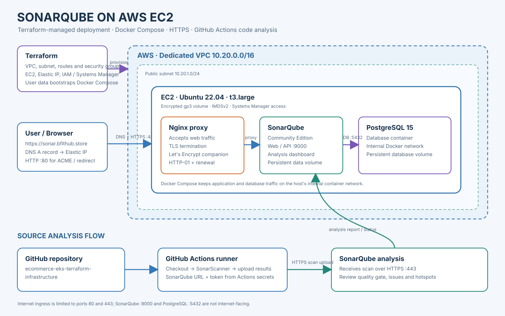
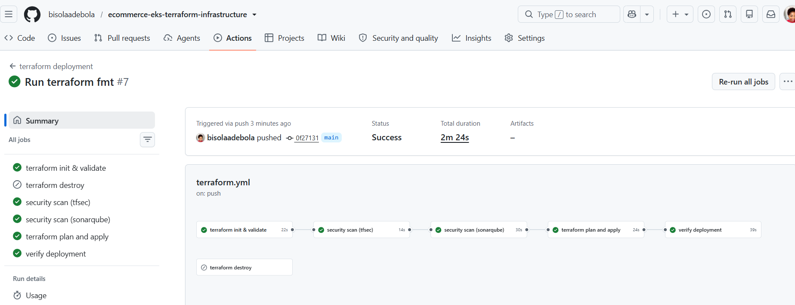
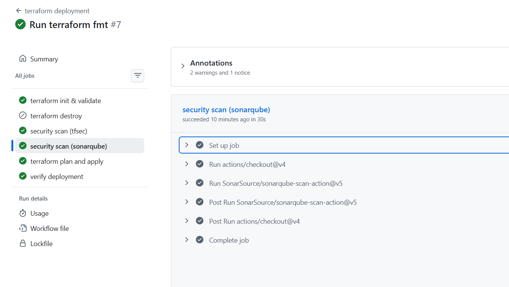
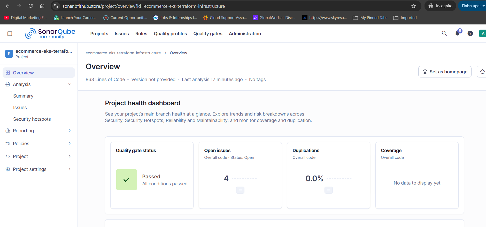
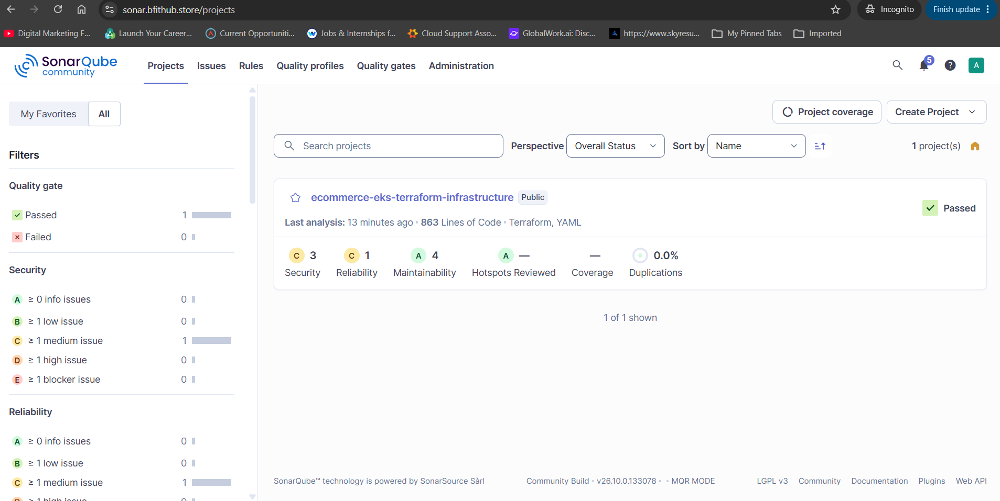
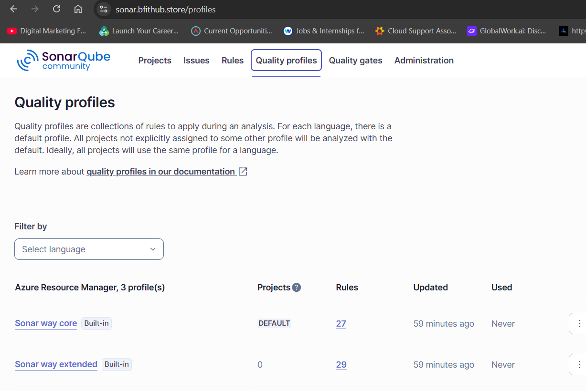

# SonarQube on AWS EC2 with Terraform

Terraform provisions a single EC2 host for SonarQube Community Edition, with PostgreSQL, an nginx reverse proxy, HTTPS certificates from Let's Encrypt, and an Elastic IP. The instance is reached through AWS Systems Manager Session Manager by default.

## What it creates

- A dedicated VPC, public subnet, internet gateway, route table, and security group
- An Ubuntu 22.04 EC2 instance (default: `t3.large`) with an encrypted gp3 root volume
- An Elastic IP for a stable DNS target
- An EC2 IAM role for Systems Manager Session Manager
- Docker Compose services for SonarQube, PostgreSQL, nginx-proxy, and the Let's Encrypt companion

The security group exposes HTTP (port 80) for certificate validation and HTTPS (port 443) for the web UI. SSH is disabled unless an EC2 key pair is configured.

## Requirements

- Terraform 1.5 or newer
- AWS CLI credentials with permission to create the resources in `main.tf`
- A DNS name you control, with permission to create an A record
- An email address for Let's Encrypt notifications

## Configure and deploy

1. Copy `terraform.tfvars.example` to `terraform.tfvars` and set your domain and Let's Encrypt email.
2. Make sure your DNS provider can point the chosen hostname to the Elastic IP. After apply, use Terraform's `public_ip` output to create an A record for the hostname.
3. Run:

   ```sh
   terraform init
   terraform plan
   terraform apply
   ```

4. Wait for DNS to resolve to the Elastic IP and for the EC2 user-data setup to complete. Then visit the `sonarqube_url` output over HTTPS.

Use `terraform output` to view the outputs. Use the `instance_id` output to connect through Systems Manager in the AWS console.

## Infrastructure scan with SonarQube

I scanned my ecommerce infrastructure in the `ecommerce-eks-terraform-infrastructure` repository with SonarQube. I generated an analysis token in SonarQube, added the SonarQube server URL and token as GitHub Actions secrets in my infrastructure repository, and ran its GitHub Actions workflow. The workflow ran SonarScanner on my Terraform code and uploaded the results to my SonarQube server over HTTPS. The scan completed successfully, and the analysis appeared in my SonarQube project.

The scan results are available in the SonarQube project overview and project list. The captured overview shows the project passing its quality gate; SonarQube also provides the analysis summary and issue details for the submitted project. The workflow and scanner screenshots document a successful run and completed analysis. The quality profile screenshot is included as a reference to the SonarQube interface; it is filtered to Azure Resource Manager and does not establish which profile was applied to the Terraform project.

The workflow reads the SonarQube URL and token from repository secrets, so the token is not stored in source code. Terraform state files and secret variable files should also stay out of source control.

## Project screenshots

### AWS architecture



### GitHub Actions workflow

Successful workflow run:



Successful SonarQube scan step:



### SonarQube project results

Project overview with the passed quality gate:



Project list showing the analyzed project and summary:



### Quality profiles

This captured view is filtered to Azure Resource Manager; it is included as a reference to the SonarQube quality profile interface and does not show the Terraform profile selection.



## Terraform state and secrets

Terraform state can contain generated database credentials and other sensitive infrastructure data. This repository ignores state files, local variable files, and Terraform's working directory. Do not commit those files. For a shared or production deployment, configure a protected remote state backend with encryption, access controls, and state locking.

## Cleanup

When you no longer need the deployment, run `terraform destroy` from the same initialized working directory and review the plan before confirming. Keep the state file available until Terraform has finished destroying the resources.
